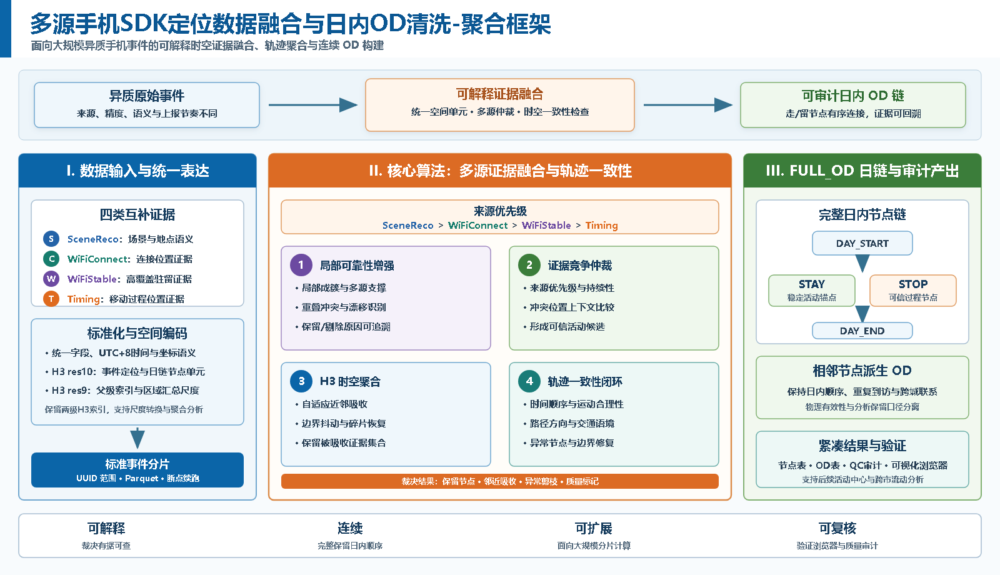

# 多源手机 SDK 定位融合与日内 OD 清洗–聚合框架

[English](README_en.md) · [大湾区在线演示](https://yecao02.github.io/Mobility-fusion-open/demo/) · [上海在线演示](https://yecao02.github.io/Mobility-fusion-open/demo/shanghai-validation/)

Mobility Fusion 将多源手机定位观测融合为可解释的活动节点与完整日内 OD 链。这里展示算法框架，以及大湾区、上海数据的识别结果，可直接对照原始观测查看处理效果。

## 算法框架

### 从观测到活动链

- **四类证据：** SceneReco（场景与地点语义）、WiFiConnect（连接位置）、WiFiStable（稳定驻留）、Timing（移动过程位置）。
- **解释性融合：** 统一时空表达，按来源优先级、持续支持及上下文裁决冲突，保留可追溯的成员支持。
- **轨迹一致性：** H3 时空聚合、邻域吸收与边界修复，结合时间顺序和运动合理性识别活动节点。
- **完整日链：** `DAY_START → STAY / STOP → … → DAY_END`；相邻节点形成 OD，语义、边界与来源审计独立保存。

默认来源优先级为 **SceneReco ＞ WiFiConnect ＞ WiFiStable ＞ Timing**。新版本进一步改进直接冲突裁决、跨日上下文、计算调度与精确存储。

## 查看识别结果

**[打开大湾区演示 →](https://yecao02.github.io/Mobility-fusion-open/demo/)**　**[打开上海演示 →](https://yecao02.github.io/Mobility-fusion-open/demo/shanghai-validation/)**

选择城市、日期与样本，查看原始观测、识别节点、OD 连线和时间轴；支持逐步播放与原始观测开关。两页已更新为全量计算成果中的样本，默认浅灰底图，可切换原彩色。

## 新版完整 Pipeline

[打开大图](assets/figures/mobility_fusion_pipeline_v8_zh.svg) · [流程说明](docs/pipeline-overview.md)

## 仓库导航

- `demo/`：大湾区交互演示。
- `demo/shanghai-validation/`：上海交互演示。
- `assets/figures/`：中英文算法框架、预览与完整流程图。
- `docs/`：方法与实现说明。
