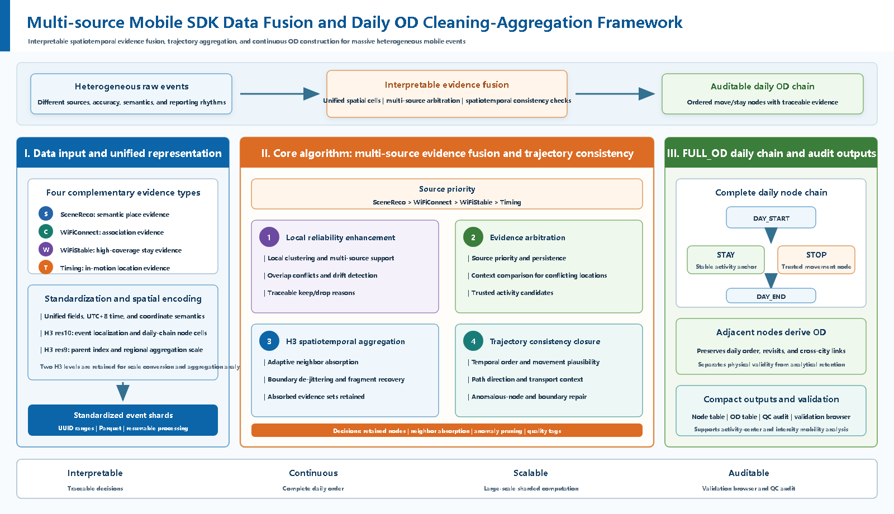
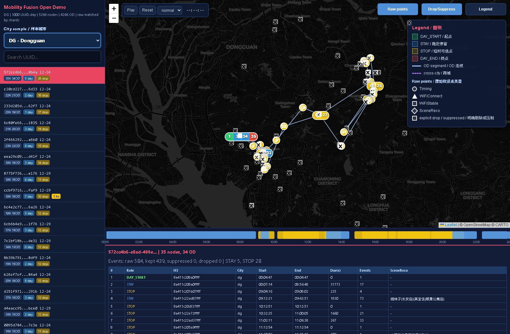

# Multi-source Mobile SDK Location Fusion and Daily OD Reconstruction

[简体中文](README.md) · [Greater Bay Area demo](https://yecao02.github.io/Mobility-fusion-open/demo/) · [Shanghai demo](https://yecao02.github.io/Mobility-fusion-open/demo/shanghai-validation/)

Mobility Fusion combines heterogeneous mobile location observations into interpretable activity nodes and ordered daily OD chains. Explore the algorithm and compare its identified results with the original observations in the Greater Bay Area and Shanghai demos.

## Algorithm framework

### From observations to activity chains

- **Four evidence streams:** SceneReco (place semantics), WiFiConnect (connection locations), WiFiStable (stable presence) and Timing (locations during movement).
- **Interpretable fusion:** align time and space, resolve competing evidence using source priority, temporal support and context, and retain supporting members.
- **Trajectory consistency:** aggregate H3 cells over time, absorb nearby evidence, repair boundaries and check temporal order and movement plausibility.
- **Daily chains:** `DAY_START → STAY / STOP → … → DAY_END`; adjacent nodes form OD links, with semantics and audit information stored separately.

The default source priority is **SceneReco > WiFiConnect > WiFiStable > Timing**. The current pipeline improves direct-conflict arbitration, cross-day context, execution scheduling and exact storage.

## Explore identified results

**[Open Greater Bay Area demo →](https://yecao02.github.io/Mobility-fusion-open/demo/)**　**[Open Shanghai demo →](https://yecao02.github.io/Mobility-fusion-open/demo/shanghai-validation/)**

Choose a city, date and sample to inspect observations, identified nodes, OD links and the timeline. Use playback and toggle the original observations. Both demos now use samples from completed full-scale results. The default basemap is light gray, with an original-color option.

## Complete current pipeline

[Open the large diagram (Chinese)](assets/figures/mobility_fusion_pipeline_v8_zh.svg) · [Pipeline overview](docs/pipeline-overview.md)

## Repository guide

- `demo/`: Greater Bay Area interactive demo.
- `demo/shanghai-validation/`: Shanghai interactive demo.
- `assets/figures/`: bilingual algorithm frameworks, preview and pipeline diagram.
- `docs/`: methods and implementation notes.
