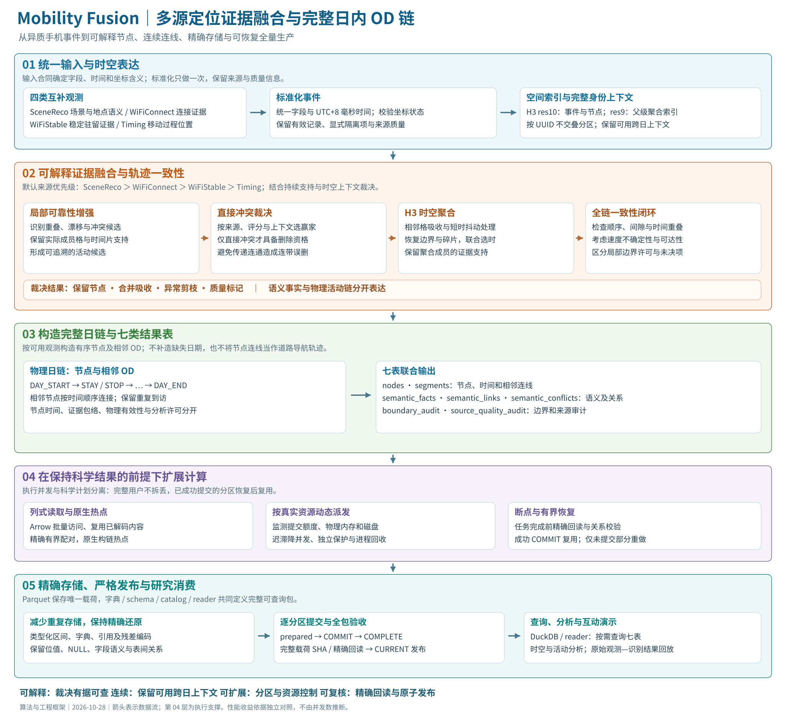

# Mobility Fusion：从多源观测到可解释日链

[中文首页](../README.md) · [English](../README_en.md) · [大湾区演示](https://yecao02.github.io/Mobility-fusion-open/demo/) · [上海演示](https://yecao02.github.io/Mobility-fusion-open/demo/shanghai-validation/)

## 算法路径

四类定位观测统一字段、毫秒时间与坐标含义，并建立 H3 空间索引。局部可靠性增强先保留真实成员支持，再结合来源、持续性及上下文裁决冲突；只有与最终赢家存在直接时空冲突时，候选才具备相应删除资格，避免连通关系引起连带删除。随后进行时空聚合、相邻吸收、抖动与边界处理，检查全链时间顺序和运动合理性。

按完整用户的可用跨日上下文处理，构造 DAY_START、STAY、STOP、DAY_END 有序节点，连接相邻 OD。语义事实及其链接、冲突、边界与来源质量独立保存，与 nodes、segments 共同组成七表。

## 计算与持久化

执行按不交叠身份分区，采用列式读取、原生热点、有界配对、进程回收与实际资源水位调度。成功分区可断点复用。Parquet 配合字典、schema、catalog 与 reader 保存精确可查询结果；分区回读与关系校验后提交，完成全包验证再原子发布 CURRENT。DuckDB 和演示页面消费已发布结果。

## 当前更新

两地演示已替换为已完成全量计算结果中的样本；可按城市、日期和样本浏览原始观测与识别节点、连线、时间轴。页面默认浅灰底图，轨迹颜色保持独立。算法与样本工程的详细技术记录分别保存在对应文档中。
